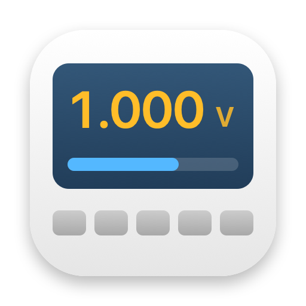
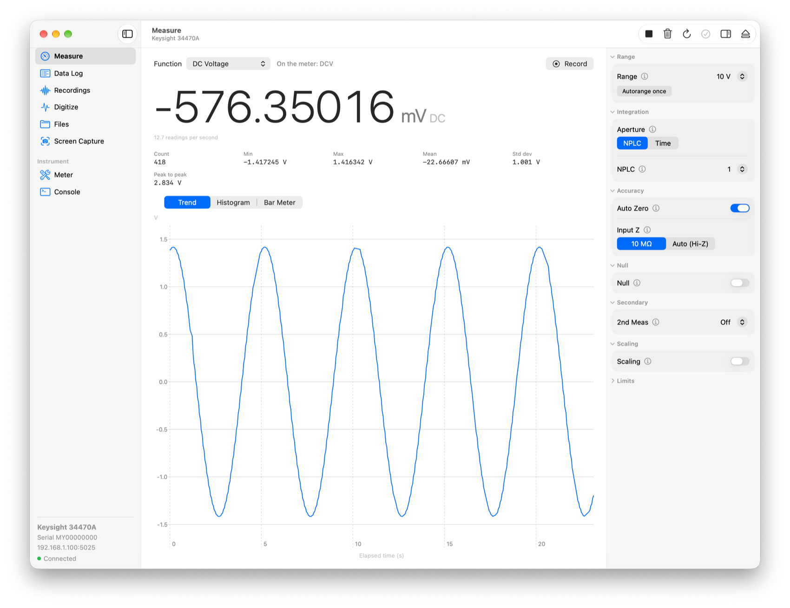
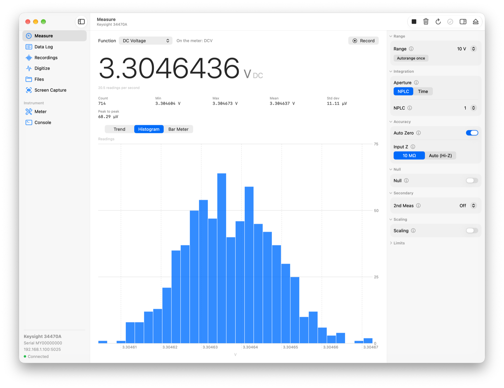
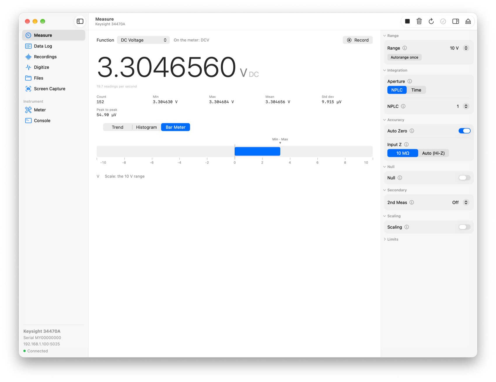
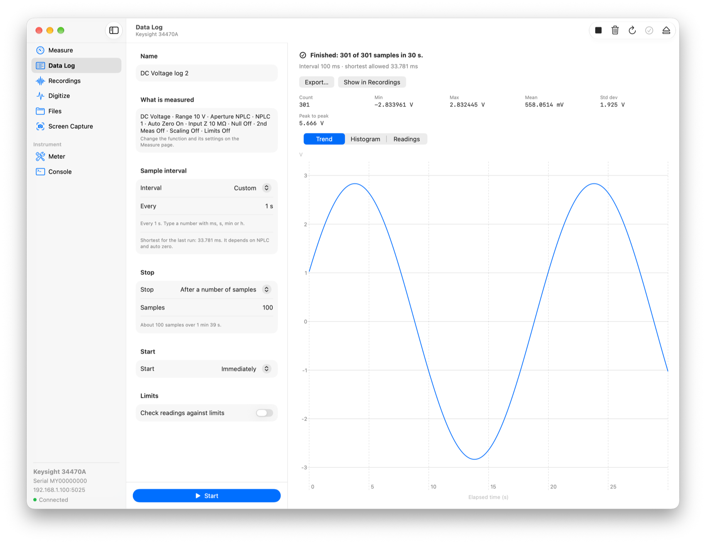
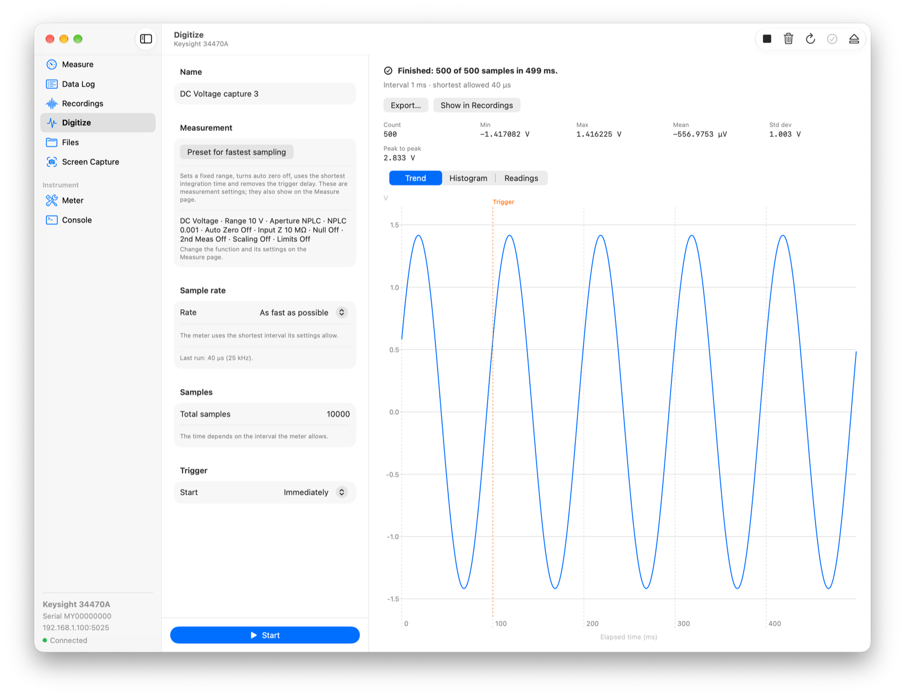
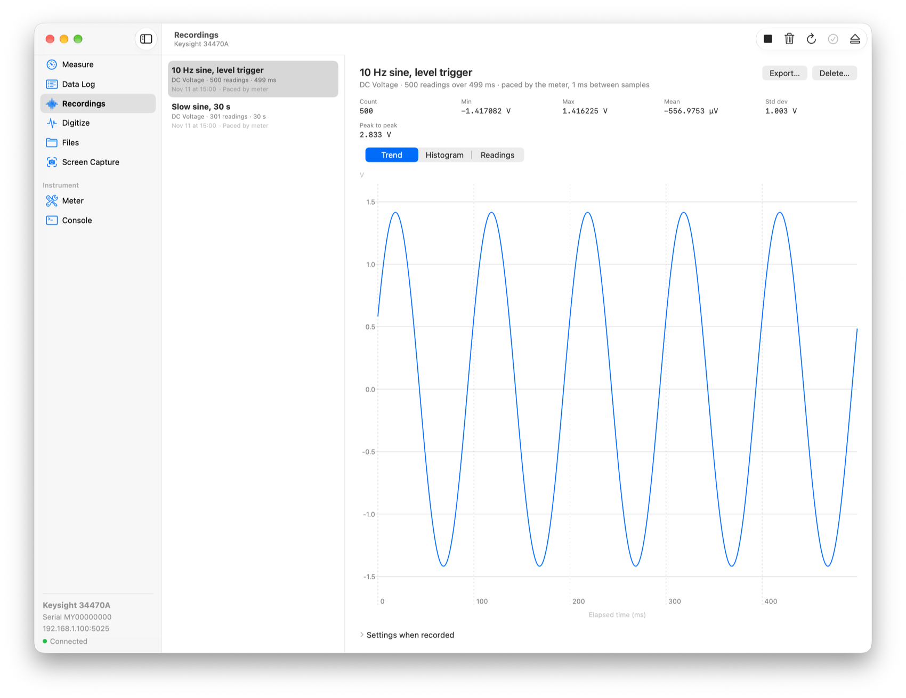
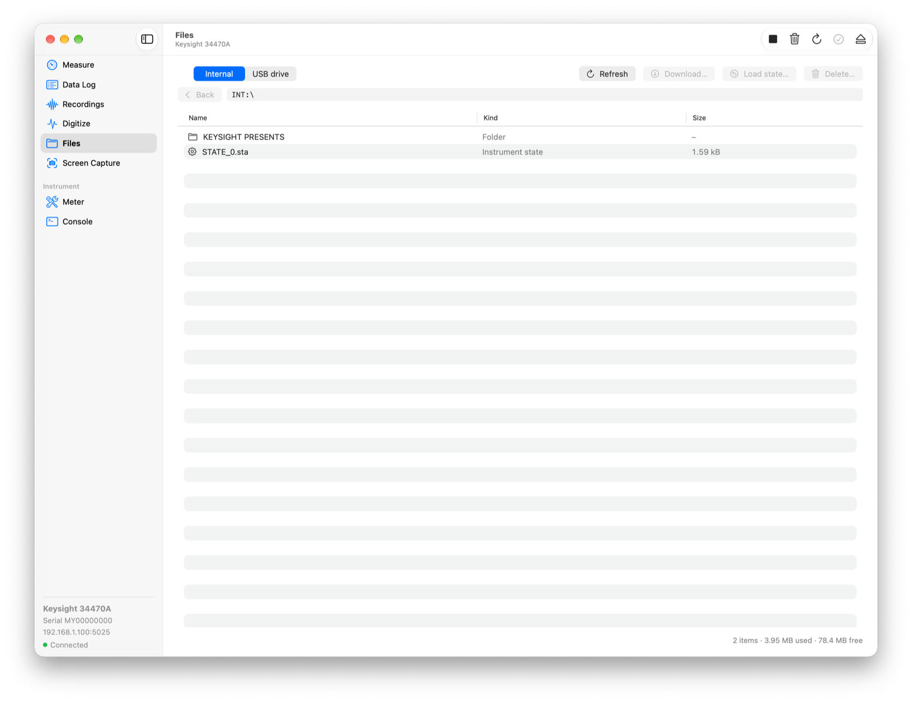
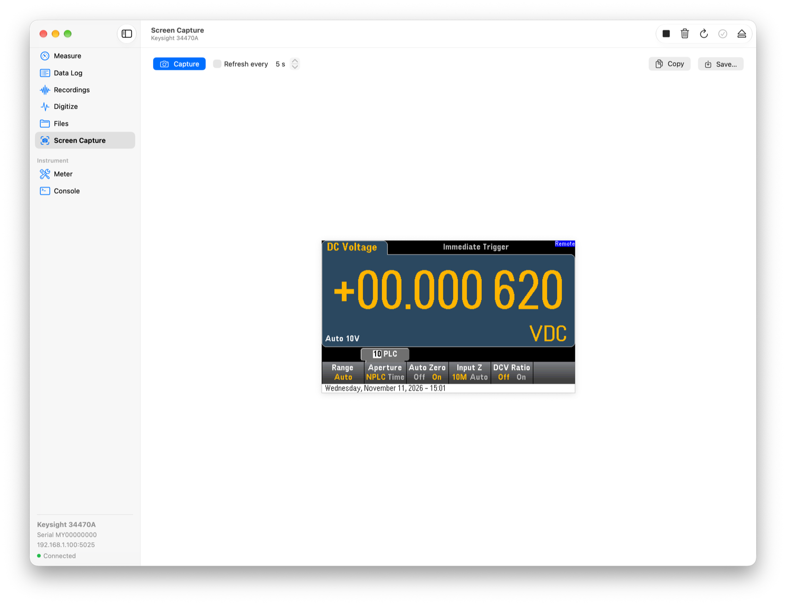
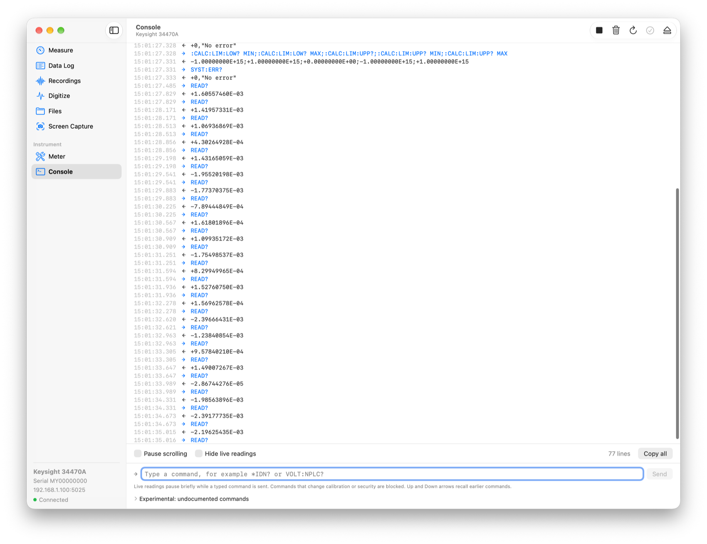

# Keysight DMM for macOS

A native Mac app for controlling a Keysight Truevolt bench multimeter (34470A, and in
principle the 34460A, 34461A and 34465A) over the network.

Keysight's own software for these meters is Windows-only. This app finds the meter on
your LAN, shows live readings, exposes the meter's settings with the same names the
front panel uses, and runs data logs and fast captures that are timed by the meter
itself.



> This is an independent project. It is not affiliated with or endorsed by Keysight
> Technologies. It has been developed and tested against one 34470A (firmware A.03.03);
> see [Status](#status) for what has and has not been verified.

## Features

### Live measurement

- All of the meter's functions: DC and AC voltage, DC and AC current, 2-wire and
  4-wire resistance, frequency, period, capacitance, temperature, continuity, diode and
  DC voltage ratio.
- A large readout with statistics (count, min, max, mean, standard deviation,
  peak to peak) and three views of the readings: trend, histogram and bar meter.
- A settings panel for each function, laid out and named like the meter's soft keys
  (Range, Aperture, Auto Zero, Input Z, Null, 2nd Meas…). Every setting has an info
  button that explains it and shows the SCPI command behind it and the manual page.
- The meter's math: dB, dBm, percent and gain/offset scaling, and limit testing.
- Record the live readings to a recording at any time.
- The app adopts whatever state the meter is in when you connect. It does not reset it.

| Histogram | Bar meter |
|---|---|
|  |  |

### Data logging, timed by the meter

A data log uses the meter's own sample timer, so the spacing between samples is exact
rather than dependent on network timing. The app collects the readings while the run is
in progress, so a log is not limited by the meter's reading memory.

- Sample as fast as the settings allow, or at an interval you choose.
- Stop by hand, after a number of samples, or after a duration.
- Start immediately or on an external trigger.
- Optional limits drawn on the chart, a count of readings outside them, and a macOS
  notification on the first one.



### Digitizing

Fast captures using the same engine: one button sets the meter up for its highest
sample rate (25,000 samples per second on DC volts on the 34470A). Captures can start
immediately, on an external trigger, or when the signal crosses a level, with samples
kept from before the trigger.



### Recordings and export

Logs, captures and live recordings are kept between launches, each with the instrument
settings in force when it was made.

- Chart, statistics and a table of readings for every recording.
- Export to CSV or JSON. Values are always written in the base unit named in the column
  header (`value_V`, never millivolts), with a period as the decimal separator whatever
  your Mac's region, so a file cannot be off by a factor of a thousand.
- Export the chart as PNG or PDF.



### Files, screen capture and maintenance

- Browse the meter's internal storage and a USB drive in its front-panel port; download
  and delete files and load saved instrument states.
- Capture the meter's display as an image.
- A Meter page with instrument details, clock setting, self-test, autocalibration,
  state save and recall, preset, and a link to the meter's built-in web interface.

| Files on the meter | Screen capture |
|---|---|
|  |  |

### SCPI console

Watch every command the app sends and every response, and type your own. The console
completes commands from a catalogue of the 324 documented ones and shows their syntax.
Commands that change calibration or security settings are blocked. A separate list
holds the undocumented commands found on the 34470A (see
[docs/experimental/NOTES.md](docs/experimental/NOTES.md)).



### Other things worth knowing

- **Discovery.** Meters are found with Bonjour; you can also connect by address. A
  built-in demo meter lets you try the app with no instrument.
- **Orderly shutdown.** Quitting or disconnecting stops any run, returns the meter to
  local control and closes the connection cleanly.
- **Light appearance**, standard Mac controls and menus.

## Requirements

- macOS 27 or later.
- Xcode 27 (Swift 6) to build. There are no third-party dependencies.
- The meter on the same network as the Mac, with its sockets interface enabled
  (the default). The app connects to TCP port 5025.

## Build and run

```sh
git clone <this repository>
cd keysight_dmm
./scripts/make_app.sh
open build/KeysightDMM.app
```

The first time, macOS asks for permission to find devices on the local network. If you
use an outbound firewall such as Little Snitch, allow the app to reach the meter on
TCP 5025.

To try it without a meter:

```sh
open build/KeysightDMM.app --args --demo
```

## Command-line tool

`dmmprobe` exercises the same library from the terminal:

```sh
swift build
.build/debug/dmmprobe discover                        # instruments found on the network
.build/debug/dmmprobe read 192.168.1.50 5             # five readings with the current setup
.build/debug/dmmprobe settings 192.168.1.50           # every setting of every function
.build/debug/dmmprobe log 192.168.1.50 0.5 20         # a meter-timed log: 20 samples, 0.5 s apart
.build/debug/dmmprobe send 192.168.1.50 'VOLT:NPLC?'  # raw SCPI
```

`dmmprobe bench <meter> <generator>` runs a validation against a Keysight 33500-series
waveform generator wired to the meter's input.

## How it is built

- `Sources/DMMKit` — the instrument library: socket transport, SCPI session, units,
  per-function settings tables, meter-timed acquisition, recordings and export, and a
  simulated meter used by the tests and the demo mode.
- `Sources/KeysightDMMApp` — the SwiftUI app.
- `Sources/dmmprobe` — the command-line tool.
- `Tests/DMMKitTests` — unit tests (`swift test`); none need hardware.

[docs/DECISIONS.md](docs/DECISIONS.md) records the design choices and what was observed
on the real instrument, including places where it differs from the manual.

## Status

Verified on a 34470A:

- Discovery, connection, live readings and settings for all functions (every setting is
  read back from the meter).
- A bench run against a waveform generator: DC volts on every range, AC volts,
  frequency and period, dBm scaling, secondary measurements, meter-timed sampling, and
  level triggering with pre-trigger samples.

Not yet verified with a real signal: current, resistance, capacitance and temperature
measurements, and external triggering. The other Truevolt models are untested; the
settings tables are written for the whole family and trimmed to what the connected meter
reports, but expect rough edges.

The Keysight manual is not included in this repository. `scripts/extract_manual.sh`
produces the text extracts the development notes refer to if you place the manual PDF
in the repository root.
